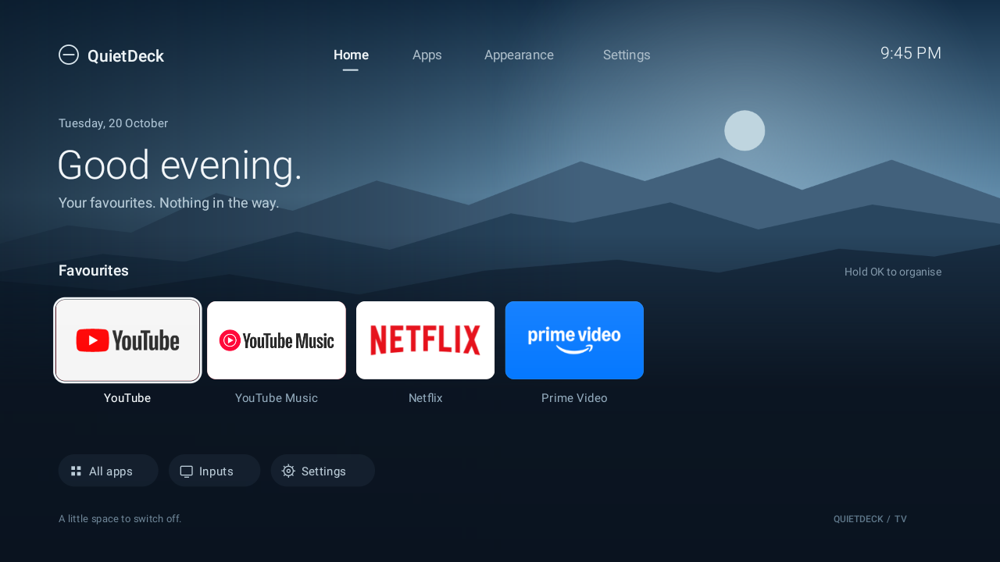
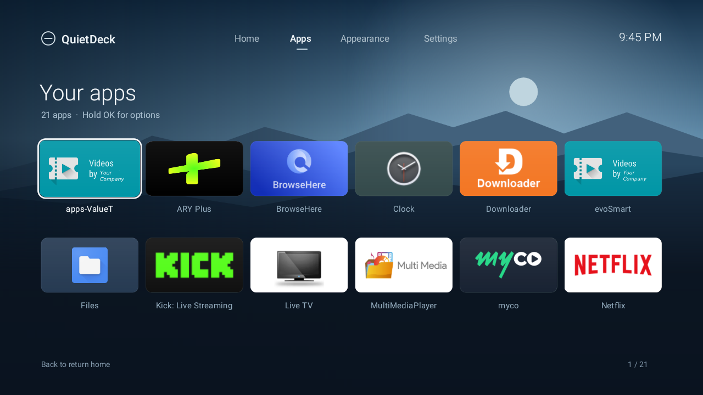

<p align="center">
  
</p>

<h1 align="center">QuietDeck TV — Minimal Android TV Launcher</h1>

<p align="center"><strong>Your apps. A quieter home screen.</strong></p>

<p align="center">
  <a href="https://github.com/junaid-devv/quietdeck-tv-launcher/actions/workflows/android.yml"></a>
  <a href="https://github.com/junaid-devv/quietdeck-tv-launcher/releases/latest"></a>
  <a href="LICENSE"></a>
  
</p>

**QuietDeck TV is a free, open-source Android TV launcher with no ads, no accounts, and no internet permission.** Replace a busy home screen with a favourites row, a complete app grid, and three quiet landscape backgrounds. Built in native Java for D-pad remotes, with no third-party runtime libraries.

<p align="center">
  <a href="https://github.com/junaid-devv/quietdeck-tv-launcher/releases/latest"><strong>Download the APK</strong></a> ·
  <a href="docs/INSTALL.md">Installation guide</a> ·
  <a href="docs/COMPATIBILITY.md">Device compatibility</a> ·
  <a href="docs/BUILD.md">Build from source</a>
</p>



## Why QuietDeck TV?

- **A focused home:** your favourite apps, local time, date, and quick access to Apps, Inputs, and Settings.
- **Less clutter:** hide apps, reorder favourites, and keep recommendations off the home screen.
- **Remote first:** navigate with arrows and OK; hold OK or press Menu for app options.
- **Three backgrounds:** Blue hour, Warm dusk, and Midnight, rendered locally without wallpaper downloads.
- **Private by design:** no requested Android permissions, analytics, advertising SDKs, or cloud account. Preferences stay on the TV.
- **Small native app:** no web view, streaming catalogue, or third-party runtime dependencies.
- **Recoverable setup:** installation and restore instructions document how to return to the original launcher.

QuietDeck changes the **home screen**. It does not remove ads from other apps, modify Android firmware, or provide streaming subscriptions.

## Screenshots

| Home and favourites | All installed apps |
| --- | --- |
|  |  |

These are captures from a physical Haier TV, not mockups. App tiles come from installed apps and will differ on your device. App names and logos belong to their respective owners.

## Install

1. Download `QuietDeck-TV-v1.1.0.apk` from [Releases](https://github.com/junaid-devv/quietdeck-tv-launcher/releases/latest).
2. Follow the [installation guide](docs/INSTALL.md) to sideload it with ADB or your TV's trusted installer.
3. Open QuietDeck TV and test navigation and app launching before changing the Home app.
4. Choose it as the Home app if your TV supports that setting. Manufacturer restrictions vary; see [Home-button setup and rollback](docs/INSTALL.md#make-it-your-home-screen).

**Requirements:** Android 6.0/API 23 or later and a landscape TV interface. The current physical test device is a Haier Android 11 TV. Google TV, other brands, and Android versions have not yet been verified; see the [compatibility table](docs/COMPATIBILITY.md).

## Remote controls

| Control | Action |
| --- | --- |
| Arrows | Move between navigation, apps, and shortcuts |
| OK / Enter | Open the selected item |
| Hold OK, Menu, or Info | Open app options |
| Back | Return from Apps to Home |
| Up from the first app row | Focus the top navigation |
| Down through app rows | Scroll the grid or page favourites |

Choose **Appearance** to change the background or restore hidden apps. Hiding an app affects QuietDeck only; it does not uninstall the app.

## Build and contribute

Open the project in Android Studio, or use JDK 17 and the included Gradle wrapper:

```bash
./gradlew lintDebug testDebugUnitTest assembleDebug
```

On Windows, run `gradlew.bat` instead. A small [SDK-only PowerShell build](docs/BUILD.md#sdk-only-build-on-windows) is also included. Debug builds use a separate app ID so they can coexist with the release.

- [Build and release instructions](docs/BUILD.md)
- [Architecture and privacy](docs/ARCHITECTURE.md)
- [FAQ and troubleshooting](docs/FAQ.md)
- [Contributing](CONTRIBUTING.md) · [Roadmap](docs/ROADMAP.md) · [Changelog](CHANGELOG.md)
- [Report a bug or device result](https://github.com/junaid-devv/quietdeck-tv-launcher/issues/new/choose)

## Project status

An early public release, tested on one physical TV. Home navigation, app launching, favourites persistence, app-grid scrolling, and Home-button return were exercised. Full screen-reader navigation, broader device testing, and localization remain open work. The [compatibility page](docs/COMPATIBILITY.md) separates tested behavior from the supported API floor.

The original prototype was named Still. Its application ID, `com.still.launcher`, is retained so signed releases can update that prototype without losing preferences.

## License

[MIT](LICENSE), copyright © 2026 Muhammad Junaid. Third-party app artwork shown in screenshots is not part of this project's artwork license. QuietDeck TV is an independent project and is not affiliated with Google, Apple, Haier, or any streaming service.
